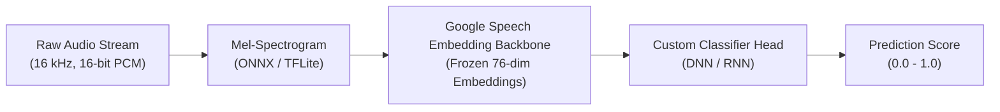

# openWakeWord: Custom Wake Word Detection & Training Pipeline

[](https://www.python.org/)
[](https://onnxruntime.ai/)
[](https://opensource.org/licenses/Apache-2.0)

**openWakeWord** is an open-source, ultra-efficient audio wake word (keyword spotting) framework designed for real-time edge devices and desktop voice interfaces. It achieves high accuracy and minimal false-activation rates by combining frozen, large-scale pre-trained speech audio embeddings with lightweight classification heads.

This repository provides an end-to-end environment for **evaluating pre-trained wake words**, **testing real-time microphone detection**, and **training robust custom wake word models** completely locally using synthetic speech generation (TTS) and acoustic data augmentation.

---

## Table of Contents

- [Key Features](#key-features)
- [Repository Structure](#repository-structure)
- [Included Models](#included-models)
  - [Custom Trained Model ("Hey Saya")](#custom-trained-model-hey-saya)
  - [Pre-Trained Base Models](#pre-trained-base-models)
- [System Requirements & Prerequisites](#system-requirements--prerequisites)
- [Installation & Setup](#installation--setup)
- [Running Wake Word Detection](#running-wake-word-detection)
  - [1. Real-Time Interactive Microphone Test (`test.py`)](#1-real-time-interactive-microphone-test-testpy)
  - [2. CLI Example Microphone Script](#2-cli-example-microphone-script)
  - [3. Integrating into Python Code](#3-integrating-into-python-code)
- [Training Custom Wake Word Models](#training-custom-wake-word-models)
  - [Piper TTS: Download & Setup](#piper-tts-download--setup)
  - [Required Assets & Datasets](#required-assets--datasets)
  - [Configuring Wake Words (`.yaml`)](#configuring-wake-words-yaml)
  - [End-to-End Training Steps](#end-to-end-training-steps)
  - [Exporting Models (ONNX & TFLite)](#exporting-models-onnx--tflite)
- [Architecture & Performance Tuning](#architecture--performance-tuning)
- [Troubleshooting & FAQs](#troubleshooting--faqs)
- [License & Acknowledgments](#license--acknowledgments)

---

## Key Features

- **High Efficiency & Low Latency**: Processes streaming 16 kHz audio in 80 ms chunks (1280 samples). Multiple models run concurrently with negligible CPU overhead.
- **100% Synthetic Data Training**: Train robust models for *any* custom word or phrase without manual voice recording, using text-to-speech synthesis (Piper) with phonetic variations.
- **Acoustic Robustness**: Incorporates Room Impulse Responses (MIT RIRs) and background noise mixing to withstand real-world environments and far-field acoustics.
- **False-Positive Suppression**: Employs thousands of hours of negative speech embeddings (ACAV100M) and custom adversarial near-miss phrases to prevent accidental activations.
- **Noise Suppression & VAD**: Integrated SpeexDSP noise suppression and Silero Voice Activity Detection (VAD) filter out background ambient static and non-speech sounds.
- **Python 3.12 & Modern Tooling Ready**: Enhanced audio I/O using `soundfile`, streamlined `onnx2tf` conversion, and memory-efficient streaming DataLoaders.

---

## Repository Structure

```text
openWakeWord/
├── openwakeword/                     # Core openWakeWord Python package
│   ├── model.py                      # Model inference engine & scoring
│   ├── train.py                      # Automated training, augmentation & export pipeline
│   ├── data.py                       # Audio dataset generator, augmentations & RIR mixing
│   ├── vad.py                        # Silero Voice Activity Detection integration
│   └── resources/
│       └── models/                   # Pre-trained base models (embedding, melspec, alexa, etc.)
├── my_custom_model_saya/             # Custom trained model directory for 'hey saya'
│   ├── hey_saya/                     # Intermediate generated clips, features, and checkpoints
│   ├── hey_saya.onnx                 # Production ONNX model graph
│   └── hey_saya.onnx.data            # ONNX weights tensor data
├── hey_saya.yaml                     # Custom wake word training configuration for 'hey saya'
├── data/                             # Pre-computed negative background embeddings & validation data
│   ├── openwakeword_features_ACAV100M_2000_hrs_16bit.npy
│   └── validation_set_features.npy
├── background_noise/                 # Background noise audio clips (.wav)
├── mit_rirs/                         # Room Impulse Response audio clips (.wav)
├── piper-sample-generator/           # Piper TTS synthetic sample generator submodule
├── test.py                           # Interactive real-time live mic test script
├── notebooks/
│   └── automatic_model_training.ipynb # Interactive training notebook
├── examples/                         # Example scripts (microphone detection, benchmarking, web)
└── setup.py                          # Package configuration and dependencies
```

---

## Included Models

### Custom Trained Model: "Hey Saya"

This repository features the custom trained **"Hey Saya"** wake word model:

| Wake Word | Model Directory | Model File | Config File | Architecture |
| :--- | :--- | :--- | :--- | :--- |
| **"Hey Saya"** | `my_custom_model_saya/` | `hey_saya.onnx` | `hey_saya.yaml` | 3-layer DNN (64 units) |

### Pre-Trained Base Models

Located under `openwakeword/resources/models/`:
- `alexa_v0.1.onnx` / `.tflite`
- `hey_jarvis_v0.1.onnx` / `.tflite`
- `hey_mycroft_v0.1.onnx` / `.tflite`
- `hey_rhasspy_v0.1.onnx` / `.tflite`
- `weather_v0.1.onnx` / `.tflite`
- `timer_v0.1.onnx` / `.tflite`
- Feature extractors: `melspectrogram.onnx`, `embedding_model.onnx`, `silero_vad.onnx`

---

## System Requirements & Prerequisites

- **Operating System**: Linux (Ubuntu 20.04/22.04/24.04 recommended), macOS, or Windows
- **Python**: Version `3.10`, `3.11`, or `3.12`
- **Audio Device**: Working microphone (for real-time live detection)

### Install System Packages (Linux / Ubuntu)

Install audio development headers, SpeexDSP, and audio decoding libraries:

```bash
sudo apt-get update
sudo apt-get install -y portaudio19-dev libspeexdsp-dev libsndfile1 ffmpeg git-lfs
```

---

## Installation & Setup

### 1. Clone the Repository & Create Virtual Environment

```bash
git clone https://github.com/dscripka/openWakeWord.git
cd openWakeWord

# Create a virtual environment
python3 -m venv .venv
source .venv/bin/activate
```

### 2. Install Dependencies

Upgrade package managers and install openWakeWord in editable mode:

```bash
pip install --upgrade pip setuptools wheel

# Install core runtime dependencies
pip install -e .

# Install dependencies for microphone testing and audio I/O
pip install pyaudio soundfile

# (Optional) For training custom models and converting to TFLite:
pip install -e ".[full]"
pip install onnx2tf
```

---

## Running Wake Word Detection

### 1. Real-Time Interactive Microphone Test (`test.py`)

A live testing utility is included in [test.py](file:///home/arz-1029/openWakeWord/test.py). It streams audio from your default input device at 16 kHz, applies Speex noise cancellation, and prints a live ASCII confidence meter with cooldown triggering.

#### Run:

```bash
python test.py
```

#### What you will see:
```text
Universal detector active for 'hey_saya'. Anyone can speak...
Confidence: 0.42 | ██████████               
🔥 [TRIGGERED] 'hey saya' detected! (Score: 0.884)
```

#### Configuration & Threshold Tuning:
In `test.py`, you can fine-tune the detection sensitivity threshold or cooldown period to best match your environment:

```python
MODEL_PATH = "my_custom_model_saya/hey_saya.onnx"
CHUNK = 1280       # 80 ms audio frames (16 kHz)
THRESHOLD = 0.65   # Sensitivity threshold (0.50 - 0.75 recommended)
COOLDOWN = 1.5    # Seconds between consecutive activations
```

---

### 2. CLI Example Microphone Script

You can also use the example script in `examples/detect_from_microphone.py`:

```bash
python examples/detect_from_microphone.py \
  --model_path my_custom_model_saya/hey_saya.onnx \
  --inference_framework onnx
```

To run with all built-in pre-trained models simultaneously:

```bash
python examples/detect_from_microphone.py --inference_framework onnx
```

---

### 3. Integrating into Python Code

Add wake word detection to any custom application in just a few lines:

```python
import numpy as np
import pyaudio
from openwakeword.model import Model

# Initialize the model engine
oww = Model(
    wakeword_models=["my_custom_model_saya/hey_saya.onnx"],
    enable_speex_noise_suppression=True,
    inference_framework="onnx"
)

# Set up PyAudio input stream (16 kHz, 16-bit mono)
CHUNK = 1280  # 80 ms chunk
p = pyaudio.PyAudio()
stream = p.open(format=pyaudio.paInt16, channels=1, rate=16000, input=True, frames_per_buffer=CHUNK)

print("Listening for wake word...")
try:
    while True:
        audio_frame = np.frombuffer(stream.read(CHUNK, exception_on_overflow=False), dtype=np.int16)
        
        # Predict confidence for the audio frame
        prediction = oww.predict(audio_frame)
        
        for model_name, score in prediction.items():
            if score >= 0.65:
                print(f"Triggered! Model: {model_name}, Score: {score:.3f}")
                oww.reset()  # Reset internal prediction buffers
finally:
    stream.stop_stream()
    stream.close()
    p.terminate()
```

---

## Training Custom Wake Word Models

You can train custom wake word models for new phrases completely locally.

### Piper TTS: Download & Setup

openWakeWord relies on [Piper Sample Generator](https://github.com/rhasspy/piper-sample-generator) (a fast, local neural text-to-speech engine based on VITS) to synthesize thousands of diverse speech clips across hundreds of distinct speaker voices, pitch variations, and speaking speeds.

#### 1. Clone Piper Sample Generator
If `piper-sample-generator/` is not already cloned in your workspace:
```bash
git clone https://github.com/rhasspy/piper-sample-generator.git
```

#### 2. Install Piper Dependencies
Install the required phonemizer and VAD audio libraries:
```bash
pip install piper-phonemize webrtcvad
# Or install from the submodule requirements:
pip install -r piper-sample-generator/requirements.txt
```

#### 3. Download Piper Voice Checkpoints
Piper synthesizes voice clips using pre-trained voice checkpoints (LibriTTS). Download the model checkpoint into `piper-sample-generator/models/`:
```bash
mkdir -p piper-sample-generator/models

# Primary LibriTTS high-quality voice model (~204 MB):
wget -O piper-sample-generator/models/en-us-libritts-high.pt \
  'https://github.com/rhasspy/piper-sample-generator/releases/download/v1.0.0/en-us-libritts-high.pt'

# (Optional) LibriTTS-R medium voice model:
wget -O piper-sample-generator/models/en_US-libritts_r-medium.pt \
  'https://github.com/rhasspy/piper-sample-generator/releases/download/v2.0.0/en_US-libritts_r-medium.pt'
```

#### 4. How Piper TTS is Used

##### A. Automated Generation via openWakeWord Pipeline (Recommended)
In your training YAML file (`hey_saya.yaml`), provide the path to `piper-sample-generator`:
```yaml
piper_sample_generator_path: "/home/arz-1029/openWakeWord/piper-sample-generator"
```
When you execute Step 1 of the training pipeline:
```bash
python openwakeword/train.py --training_config hey_saya.yaml --generate_clips
```
`openwakeword/train.py` dynamically imports `generate_samples` from `piper-sample-generator/generate_samples.py` and automatically:
- Generates synthetic positive clips for `"hey saya"` (and any phonetic variations defined in `target_phrase`).
- Generates adversarial negative clips (phonetic near-misses such as `"hey sarah"`, `"saya"`, etc.).
- Randomly varies speaking speeds (`length_scales`), acoustic noise (`noise_scales`), and speaker interpolations (`slerp_weights`).

##### B. Standalone CLI Sample Generation (Testing / Verification)
You can also generate synthetic samples directly with Piper from the terminal to inspect the output:
```bash
cd piper-sample-generator
python generate_samples.py "hey saya" \
  --max-samples 10 \
  --batch-size 2 \
  --output-dir ../test_generated_clips/
cd ..
```
This generates 10 distinct `.wav` audio files in `test_generated_clips/`, allowing you to listen to how Piper articulates the wake word across different simulated voices.

---

### Required Assets & Datasets

Ensure the following assets are present in the project directory:

1. **Piper Sample Generator** (`piper-sample-generator/`): Used for generating high-diversity synthetic speech across hundreds of voices.
2. **Room Impulse Responses** (`mit_rirs/`): Audio clips simulating room acoustics and reverberation.
3. **Background Noise** (`background_noise/`): Diverse environmental noises mixed into synthetic speech.
4. **Pre-computed Negative Features** (`data/`):
   - `openwakeword_features_ACAV100M_2000_hrs_16bit.npy` (~17 GB): 2,000 hours of background speech/sound embeddings.
   - `validation_set_features.npy` (~184 MB): Validation embeddings for false-positive rate assessment.

---

### Configuring Wake Words (`.yaml`)

Define target phrases, adversarial negative phrases, and hyperparameters in a YAML configuration (e.g., `hey_saya.yaml`):

```yaml
# Target phrase configuration
model_name: "hey_saya"
target_phrase:
  - "hey saya"
  - "hey sai-ya"
  - "hey sigh-ya"
  - "hey sah-ya"
  - "hay saya"

# Adversarial & near-miss phrases to force phoneme contrast and suppress false positives
custom_negative_phrases:
  - "hey sarah"
  - "hey siri"
  - "hey simon"
  - "hey sonia"
  - "saya"
  - "say that"
  - "hey there"
  - "science"
  - "silence"

# Synthesis and Augmentation settings
piper_sample_generator_path: "/home/arz-1029/openWakeWord/piper-sample-generator"
rir_paths:
  - "/home/arz-1029/openWakeWord/mit_rirs"
background_paths:
  - "/home/arz-1029/openWakeWord/background_noise"
background_paths_duplication_rate:
  - 1

# Dataset size
n_samples: 25000
n_samples_val: 3000
tts_batch_size: 32
augmentation_batch_size: 16
clip_duration: 3.0
total_phases: 1
augmentation_rounds: 2
max_negative_weight: 1500

# Output directory
output_dir: "/home/arz-1029/openWakeWord/my_custom_model_saya"

# Feature datasets
feature_data_files:
  "ACAV100M": "/home/arz-1029/openWakeWord/data/openwakeword_features_ACAV100M_2000_hrs_16bit.npy"
false_positive_validation_data_path: "/home/arz-1029/openWakeWord/data/validation_set_features.npy"

# Network architecture
model_type: "dnn"
layer_size: 64
n_layers: 3
steps: 25000

# Class balancing & Penalties
batch_n_per_class:
  "ACAV100M": 1024
  "adversarial_negative": 150
  "positive": 50

lr: 0.001
false_activation_penalty: 8000
target_false_positives_per_hour: 0.0
weight_decay: 0.00001
```

---

### End-to-End Training Steps

Run each stage sequentially using `openwakeword/train.py`:

#### Step 1: Generate Synthetic Clips
Generates synthetic positive audio for the target phrase and adversarial negative audio:
```bash
python openwakeword/train.py --training_config hey_saya.yaml --generate_clips
```

#### Step 2: Augment Clips & Extract Audio Features
Applies pitch shifting, time stretching, room impulse responses (RIRs), background noise mixing, and computes embeddings:
```bash
python openwakeword/train.py --training_config hey_saya.yaml --augment_clips
```

#### Step 3: Train Classifier Network
Trains the custom neural network head on top of the feature representations:
```bash
python openwakeword/train.py --training_config hey_saya.yaml --train_model
```

Once training completes, the model will automatically be validated and exported to ONNX format in the specified `output_dir`.

#### Step 4 (Optional): Convert to TFLite
To create an optimized TFLite model for embedded devices:
```bash
python openwakeword/train.py --training_config hey_saya.yaml --convert_to_tflite
```

---

## Architecture & Performance Tuning

### The 3-Tier openWakeWord Pipeline



1. **Mel-Spectrogram Generation**: Converts raw 80 ms audio frames into fixed frequency representations.
2. **Speech Embedding Backbone**: Google's pre-trained speech embedding model extracts semantic acoustic representations.
3. **Task-Specific Classifier**: Lightweight feed-forward or recurrent neural network that outputs activation probability.

### Performance Tuning Tips

- **Detection Threshold**: Default is typically `0.5`. In real environments with ambient noise, set between `0.60` and `0.75` in `test.py` to prevent false activations.
- **Phonetic Variations**: If the model fails to detect accents, add alternative phonetic spellings to `target_phrase` in the YAML (e.g., `"hey sah-ya"`, `"hey sai-ya"`).
- **Adversarial Negative Mining**: If the model frequently mis-triggers on similar-sounding words, add those words to `custom_negative_phrases` and re-train.
- **Cooldown & Reset**: When building an interface, always call `oww.reset()` and enforce a 1.0–2.0 second cooldown after detection to prevent repeated triggers on the same utterance.

---

## Troubleshooting & FAQs

### 1. `PyAudio` fails to find an input device or throws ALSA errors
- Ensure your microphone is plugged in and recognized: `arecord -l`.
- If PyAudio prints verbose ALSA/JACK warnings, these are standard Linux driver notices and generally safe to ignore as long as audio capture proceeds.

### 2. Audio loading error (`torchaudio` vs. `soundfile`)
- This repository has been updated to use `soundfile` in `openwakeword/data.py` for cross-version stability under Python 3.12 without requiring specific Sox or FFmpeg backends in torchaudio.

### 3. High memory usage during model training
- The negative background feature dataset (`ACAV100M`) is approximately 17 GB. The training pipeline uses `StridedFeatureDataset` with memory-mapped array slicing to avoid copying datasets entirely into system RAM.

### 4. TFLite conversion issues
- TFLite conversion utilizes `onnx2tf`. If conversion encounters shape issues, verify that your virtual environment has `onnx2tf` installed (`pip install onnx2tf`).

---

## License & Acknowledgments

- **Code License**: [Apache 2.0 License](https://opensource.org/licenses/Apache-2.0).
- **Base Pre-Trained Models**: Creative Commons Attribution-NonCommercial-ShareAlike 4.0 International ([CC BY-NC-SA 4.0](https://creativecommons.org/licenses/by-nc-sa/4.0/)).
- **Created by**: [David Scripka](https://github.com/dscripka/openWakeWord).
- **Special Thanks**: To the open-source audio ML community, Piper TTS project, MIT for Room Impulse Responses, and the Home Assistant & Rhasspy voice communities.
